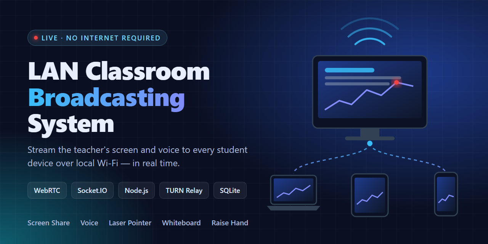

<div align="center">



# 🖥️ LAN-Based Classroom Broadcasting System

**Real-time screen and voice broadcasting for classrooms — over local Wi-Fi, with zero internet dependency.**


**Built by [Saif Ur Rehman Akhtar](https://github.com/saifofficial-dev)**

</div>

---

## 📖 Overview

The **Classroom Broadcasting System** lets a teacher stream their screen and microphone live to every student device on the same local network. Students open a browser, pick a live classroom from a list, and start watching — no apps to install, no room codes to type, and no internet connection required.

The system is designed for real-world school and lab networks, where internet access is unreliable and Wi-Fi routers often block direct device-to-device traffic. A **built-in LAN TURN relay** makes sure the video still gets through.

---

## ✨ Key Features

| Feature | Description |
|---|---|
| 📡 **Live Screen Broadcast** | Teacher shares a screen or window via WebRTC; students see it in real time |
| 🎤 **Voice Broadcasting** | Teacher's microphone streams alongside the screen, with a one-click mute toggle |
| 👆 **Laser Pointer** | A pointer that follows the teacher's mouse, shown on every student screen |
| 🎨 **Whiteboard** | Draw and annotate on a shared canvas over the broadcast |
| ✋ **Raise Hand** | Students raise a hand; the teacher is notified instantly |
| 🏫 **Classroom Discovery** | Students browse live classrooms as cards and join with one click |
| 🔐 **Password-Protected Rooms** | Optional bcrypt-hashed password per classroom |
| 🔁 **Session Recovery** | Rooms survive teacher disconnects *and* server restarts; the teacher reclaims the room automatically |
| 🌐 **Offline TURN Relay** | Built-in TURN server relays media when Wi-Fi blocks peer-to-peer traffic |
| 🔒 **Dual HTTP / HTTPS** | Students on plain HTTP (no certificate warning); teacher on HTTPS (required for screen capture) |
| 📦 **Single-File Executable** | Packages into a standalone Windows `.exe` with `pkg` — no Node.js needed on the target PC |
| 🖥️ **Fullscreen Viewer** | Students can watch the broadcast fullscreen |

---

## 🏗️ Architecture

```
                    ┌────────────────────────────────────────────┐
                    │            Classroom Server (Node.js)      │
                    │                                            │
                    │  Express ── static apps, REST API          │
                    │  Socket.IO ── signaling, rooms, pointer    │
                    │  TURN relay (UDP 3478) ── media fallback   │
                    │  SQLite ── classrooms, sessions, files     │
                    └───────┬──────────────────────────┬─────────┘
             HTTPS :3001    │                          │   HTTP :3000
                            │                          │
                 ┌──────────▼─────────┐     ┌──────────▼──────────┐
                 │   Teacher Browser  │     │  Student Browsers   │
                 │  getDisplayMedia() │     │  (phones, laptops,  │
                 │  getUserMedia()    │     │   lab PCs)          │
                 └──────────┬─────────┘     └──────────▲──────────┘
                            │      WebRTC (P2P or      │
                            └──────── TURN relay) ─────┘
                                  video + audio
```

### How a broadcast connects

1. The teacher creates a classroom; the server registers the room and announces it to all students (`rooms:updated`).
2. A student joins the room from the classroom list.
3. The teacher starts broadcasting and sends a WebRTC **offer** to each student through Socket.IO.
4. Students reply with an **answer**; both sides exchange ICE candidates (buffered until the peer connection is ready).
5. Both browsers fetch `/api/ice-config`, which points them to the server's own **TURN relay** on the LAN. If a direct connection is not possible, media is relayed through the server.

---

## 📋 Requirements

- **Node.js 18+** (only on the machine running the server — not needed if you use the `.exe` build)
- All devices on the **same Wi-Fi / LAN**
- **Google Chrome** or **Microsoft Edge** (recommended)
- Firewall access for the ports below

| Port | Protocol | Purpose |
|---|---|---|
| `3000` | TCP | Student app (HTTP) |
| `3001` | TCP | Teacher app (HTTPS) |
| `3478` | UDP | TURN relay |
| `49160–49400` | UDP | TURN relay media ports |

---

## 🚀 Quick Start

### 1. Clone and install

```bash
git clone https://github.com/saifofficial-dev/LAN-based-classroom-broadcasting-system.git
cd LAN-based-classroom-broadcasting-system/server
npm install
```

### 2. Start the server

```bash
npm start
```

The server detects your LAN IP and prints the URLs:

```
=== Classroom Server Running ===
Student:  http://192.168.1.10:3000/student  (no cert)
Teacher:  https://192.168.1.10:3001/teacher  (accept cert once)
================================
```

On Windows you can also double-click **`start-server.bat`**.

### 3. Teacher

1. Open `https://<server-ip>:3001/teacher` in Chrome.
2. Accept the self-signed certificate once (**Advanced → Proceed**). HTTPS is required by browsers for screen capture.
3. Enter your name and click **Create Classroom** — choose a room code (e.g. `MATH-101`) and an optional password.
4. Click **Start Broadcast**, pick the screen or window to share, and allow microphone access.
5. Use **Mic**, **Pointer** and **Whiteboard** from the toolbar as needed.

### 4. Students

1. Open `http://<server-ip>:3000/student` on any device on the same network.
2. Enter your name and click **Browse Classrooms**.
3. Click a **LIVE** classroom card to join (enter the password if asked).

No certificate warning and no IP configuration — the student app connects to whichever host served it.

---

## 🎮 Teacher Controls

| Control | Action |
|---|---|
| **Create Classroom** | Open a new room (or reclaim a room restored after a restart) |
| **Start / Stop Broadcast** | Begin or end screen + microphone sharing |
| **Mic: Muted / Mic: ON** | Toggle the microphone (starts muted) |
| **Pointer** | Toggle the laser pointer over the broadcast area |
| **Whiteboard** | Toggle the annotation canvas |
| **End Session** | Close the room permanently and notify all students |

---

## 🔁 Reliability & Session Recovery

- **Teacher disconnects** — the room is kept alive and students see *"waiting for reconnect"* instead of being kicked out. When the teacher returns with the same room code, the room is reclaimed and broadcasting resumes.
- **Server restarts** — active rooms are saved to `rooms-snapshot.json` (room code, teacher name, password hash) and restored on startup.
- **Deliberate end** — only **End Session** closes a room for good.

---

## 📦 Building a Standalone Executable (Windows)

The server can be packaged into a single `.exe` that bundles the teacher and student apps:

```bash
cd server
npx pkg .
```

The output is written to `server/dist/classroom-server.exe`. Copy it to any Windows PC and run it — the database, uploads and room snapshot are created next to the executable. `start-server.vbs` shows how to launch it silently in the background (for example at Windows startup).

---

## ⚙️ Configuration

Settings are read from environment variables (or `server/.env`):

| Variable | Default | Description |
|---|---|---|
| `PORT` | `3000` | HTTP port (student app) |
| `PORT_SSL` | `3001` | HTTPS port (teacher app) |
| `DB_PATH` | `database/classroom.db` | SQLite database file |
| `TURN_PORT` | `3478` | TURN relay UDP port |
| `TURN_MIN_PORT` / `TURN_MAX_PORT` | `49160` / `49400` | TURN relay port range |
| `TURN_USER` / `TURN_PASS` | `classroom` / `classroom-lan` | TURN credentials — **change these for real deployments** |
| `JWT_SECRET` | — | Secret for API tokens |

> The self-signed TLS certificate is generated automatically on startup (via `node-forge`) with the LAN IP in its SAN, so Chrome accepts it after the one-time warning.

---

## 📁 Project Structure

```
classroom-lan/
├── server/                        # Node.js backend
│   ├── src/
│   │   ├── index.js               # Entry point: HTTP + HTTPS + Socket.IO + TURN
│   │   ├── config/database.js     # SQLite connection
│   │   ├── database/              # schema.sql + migration
│   │   ├── api/
│   │   │   ├── middleware/        # auth, LAN-only filter
│   │   │   └── routes/            # auth, classroom, sessions, files
│   │   ├── signaling/
│   │   │   ├── signalingServer.js # Socket.IO events (rooms, WebRTC, pointer)
│   │   │   └── roomManager.js     # Room state + snapshot persistence
│   │   └── utils/
│   │       ├── turnServer.js      # Built-in LAN TURN relay
│   │       ├── generateCert.js    # Self-signed TLS certificate
│   │       ├── networkUtils.js    # LAN IP detection
│   │       └── logger.js          # Winston logger
│   └── package.json
├── teacher-app/public/index.html  # Teacher UI
├── student-app/public/index.html  # Student UI
├── mediasoup-sfu/                 # Optional SFU for very large classes (experimental)
├── docker-compose.yml
├── start-server.bat               # Windows launcher (Node.js)
├── start-server.vbs               # Windows silent launcher (.exe build)
├── DEPLOYMENT.md
└── README.md
```

---

## 🛠️ Tech Stack

| Layer | Technology |
|---|---|
| Backend | Node.js, Express |
| Real-time signaling | Socket.IO 4 |
| Media | WebRTC (`getDisplayMedia`, `getUserMedia`) |
| NAT traversal | `node-turn` (self-hosted LAN TURN relay) |
| Database | SQLite 3 |
| Security | node-forge (TLS), bcrypt (room passwords), JWT |
| Logging | Winston |
| Packaging | pkg (standalone Windows executable) |
| Frontend | Vanilla HTML, CSS, JavaScript |

---

## 🐛 Troubleshooting

<details>
<summary><b>Students see a black screen or "Waiting for broadcast…"</b></summary>

- Make sure the teacher clicked **Start Broadcast** and selected a screen.
- Allow UDP `3478` and `49160–49400` through the server's firewall so the TURN relay works.
- Open DevTools (`F12`) → Console and look for `[WebRTC]` logs.
</details>

<details>
<summary><b>Teacher page won't open / certificate error</b></summary>

- Use **`https://`** and port **3001** for the teacher page.
- Click **Advanced → Proceed** on the warning. If you see `ERR_SSL_VERSION_OR_CIPHER_MISMATCH`, restart the server and hard-refresh (`Ctrl+Shift+R`).
</details>

<details>
<summary><b>Students can't reach the server</b></summary>

- Confirm both devices are on the same network.
- Allow Node.js (or `classroom-server.exe`) on TCP `3000` and `3001` in Windows Firewall.
- Some public/guest Wi-Fi networks enable *client isolation*, which blocks device-to-device traffic entirely — use a private network or hotspot.
</details>

<details>
<summary><b>No audio on student devices</b></summary>

- The teacher's mic starts **muted** — click **Mic: Muted** to turn it on.
- Check the browser's microphone permission and the OS mic level.
</details>

---

## 🗺️ Roadmap

- [ ] SFU mode (mediasoup) for classes beyond ~30 students
- [ ] Session recording
- [ ] In-class chat and file sharing UI
- [ ] Electron desktop app for the teacher

---

## 👨‍💻 Author

**Saif Ur Rehman Akhtar**
AI Automation Engineer, Khalis Group of Companies · Co-Founder & Technical Manager, Flow Matrix

[](https://github.com/saifofficial-dev)

If this project helped you, consider giving it a ⭐ on GitHub.

---

## 📜 License

Released under the **MIT License** — free for educational and institutional use.

© 2026 Saif Ur Rehman Akhtar
